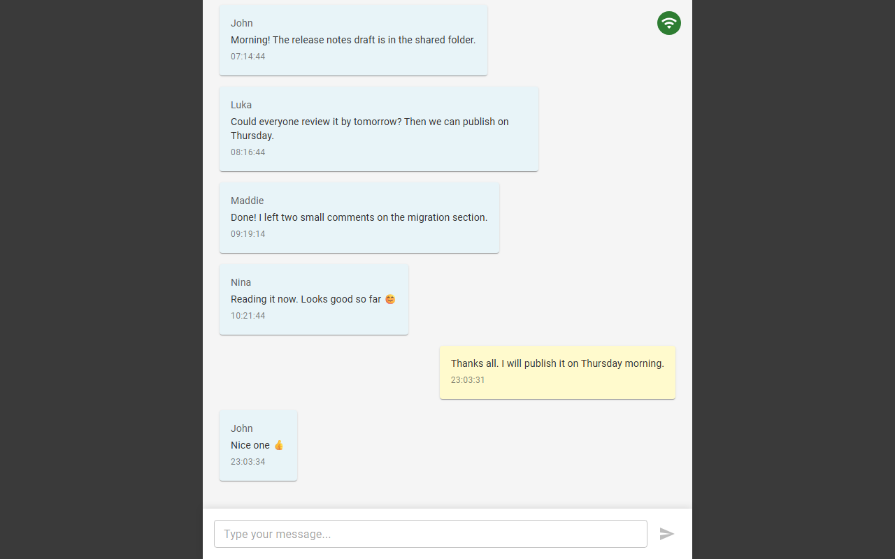

# Realtime Chat

[](https://github.com/Knightly95/realtime-chat/actions/workflows/deploy.yml)
[](#testing)

**[▶ Live demo](https://knightly95.github.io/realtime-chat/)**: runs entirely in your browser. No sign-up or backend is needed.

> **Background:** I built this project as a take-home for a frontend technical assessment in a hiring process, then moved it to my personal account and replaced the original backend with a built-in mock API. The commit history is the original one.

A small group-chat client built with React and TypeScript. It focuses on a clean API layer, predictable state, and tests at every level: unit, integration and end-to-end.

## Screenshot

[](docs/screenshots/chat.png)

Your messages are on the right. With auto-refresh on (the green button), a simulated teammate's reply arrives without a reload.

## Features

- **Message list and composer:** your own messages are aligned and styled differently from other people's, with timestamps. Enter sends; Shift+Enter adds a new line.
- **Auto-refresh toggle:** the Wi-Fi button in the top-right corner polls for new messages every 5 seconds. It stands in for a WebSocket subscription, which the original API did not offer.
- **Simulated teammates:** in the demo, another participant replies a few seconds after you send a message. Turn auto-refresh on to see the reply arrive without reloading.
- **Persistent demo data:** messages are saved in your browser, so they survive a reload and are shared between tabs.
- **Error handling:** failed requests show a clear message and never crash the page.

## Tech stack

React 19 · TypeScript · Vite · Zustand · Material UI · React Router · MSW · Vitest + React Testing Library · Playwright

## Getting started

Prerequisite: Node.js 22 or newer.

```bash
npm install
npm run dev        # http://localhost:5173
```

| Script                  | What it does                            |
| ----------------------- | --------------------------------------- |
| `npm run dev`           | Start the dev server                    |
| `npm run build`         | Type-check and build for production     |
| `npm run preview`       | Serve the production build locally      |
| `npm run lint`          | Run ESLint                              |
| `npm test`              | Run unit and integration tests (Vitest) |
| `npm run test:coverage` | Run the tests with a coverage report    |
| `npm run e2e`           | Run the end-to-end tests (Playwright)   |

## API

The app uses two endpoints:

| Method | Path               | Description                                                     |
| ------ | ------------------ | --------------------------------------------------------------- |
| GET    | `/api/v1/messages` | List messages, oldest first. Query: `after`, `before`, `limit`  |
| POST   | `/api/v1/messages` | Create a message from `{ "message": string, "author": string }` |

### Mock API (default)

By default, requests are answered inside the browser by [MSW](https://mswjs.io/). The code is in [`src/mocks`](src/mocks):

- `handlers.ts`: the two endpoints, input validation and the simulated teammate replies
- `store.ts`: persistence in `localStorage`
- `data/messages.ts`: the seed conversation

To reset the demo, run `localStorage.removeItem('realtime-chat:mock-messages:v1')` in the browser console and reload.

### Using a real backend

Create a `.env.local` file:

```dotenv
VITE_API_URL=https://your-api.example.com/api/v1
VITE_API_TOKEN=your-token   # sent as a Bearer token
```

When `VITE_API_URL` is set, the mock API is not started.

## Testing

- **Unit and integration** (Vitest, React Testing Library): components, the store, the API layer, utilities and the mock API's filtering logic.
- **End-to-end** (Playwright): the chat page through a page object, with the network stubbed so the tests are deterministic.

CI measures line coverage of the unit and integration tests on every push to `main` and publishes the number shown in the badge above.

### Quality checks

A second CI job builds the app and checks what visitors get:

- **Lighthouse** (mobile settings): the build fails if accessibility drops below 95 or best practices below 90; performance and SEO are reported. Last run: performance 96, accessibility 100, best practices 100, SEO 100.
- **Bundle budget:** the JavaScript sent to the browser must stay under 260 kB gzip (today: 246.9 kB). To check locally: `npm run build && node scripts/bundle-budget.mjs dist 260`.

The Lighthouse report is attached to each CI run.

## Deployment

Every push to `main` is linted, tested (unit and end-to-end), built and deployed to GitHub Pages by [`.github/workflows/deploy.yml`](.github/workflows/deploy.yml).

## Documentation

- [`CONTRIBUTING.md`](CONTRIBUTING.md): setup, checks, conventions and how to propose a change.
- [`AGENTS.md`](AGENTS.md): commands, rules and guardrails for AI coding agents.
- [`architecture-decision-record.md`](architecture-decision-record.md): why Zustand, Material UI, MSW, Vitest and Playwright were chosen, and the trade-offs considered.
